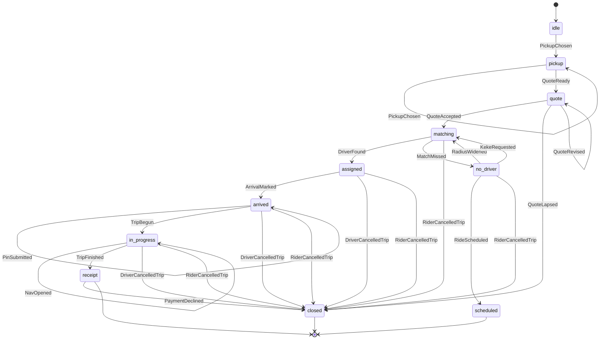

# Trip lifecycle

The rider and driver UI share one sealed state machine, `TripMachine` in `shared/flutter/along_design/lib/src/flows/trip_machine.dart`. Illegal edges throw `TripTransitionException`. A wrong PIN stays on `arrived` with `rejected: true` and does not start the trip.

This machine is the client lifecycle. Once a trip row exists, the server function `trip_transition` (blueprint §10) is still the source of truth for `requested` and later. The phases before that row (idle, pickup, quote, matching) are device-local.

## State diagram

`TripBegun` is legal only when `arrived.verified` is true. `QuoteAccepted` is legal only while the quote has time left.

## What each phase shows

| Phase | Screen | What the person sees |
| --- | --- | --- |
| pickup | `AlongFlowPickup` | Detected fix, draggable pin, entrance chips |
| quote | `AlongFlowQuote` | Base, seat, fees, wallet credit, expiry, cancel line |
| matching | `AlongFlowMatching` | Search rings. Rotation, or a fade when reduce-motion is on |
| no_driver | `AlongFlowRecovery` | Widen radius, schedule, try keke |
| assigned | `AlongFlowTripPin` | Rider reads the 4-digit PIN |
| arrived | `AlongFlowDriver` | Arrived, enter PIN, then start and complete |
| in_progress navigating | `AlongFlowNav` | ETA range and a stale-GPS line |
| receipt | `AlongFlowReceipt` | Fare, seat motif, Report an issue |
| closed | `AlongFlowNotices` | Denied, approximate, offline, cancelled, quote changed, payment failed, resumed |

`AlongFlowSettings` holds the haptics toggle. It is not a trip phase. Reduce motion is the system setting: movement becomes a fade (`AlongPressable`, `AlongStagger`, the search rings).

Swipe-to-confirm keeps the gesture and adds a 48dp check button (`confirm_without_swipe`) that fires the same callback.

## Demo versus live

`DemoAdapter` (`demo_adapter.dart`) is the only scripted source for GPS, dispatch, quotes, the PIN, and payment in these screens. Debug builds, including widget tests, show an on-screen `Demo` mark (`AlongDemoMark`, semantics label `DemoAdapter`). Release builds hide the mark. The reducer itself is not scripted: the same edges will take live adapter values later.

| Data | Today | Live replacement |
| --- | --- | --- |
| Detected fix, entrance snap, ETA range, GPS age | `DemoAdapter.detected`, `landmarks`, `snap`, `gps` | Device location and the routing service |
| Fare lines and expiry | `DemoAdapter.quote` | `resolve_fare` plus the quote clock |
| Search result, widen, keke, schedule | Screens call `_noop`; the reducer accepts the events | Edge `dispatch` |
| PIN `4821` | `DemoAdapter.pin`, compared on device | Server check before `accepted → boarded` |
| Payment label and failure | `DemoAdapter.payment` | Payments row. Failure is `PaymentDeclined` |
| Notices copy | `DemoAdapter.notices` | The same sentences, fed by real errors |
| Map tiles | Baked extract in the design package | The same tiles, or a live style |
| SOS | Copy tells the person to call 112 and share with contacts | `tel:112` and the contact share. No staffed desk and no 24/7 promise |

Server statuses that correspond once a row exists:

| Client phase | Server `trip_transition` |
| --- | --- |
| matching, then assigned | `requested` → `accepted` |
| arrived, PIN verified, begun | `accepted` → `boarded` → `in_transit` |
| receipt | `in_transit` → `completed` |
| closed `driver_cancelled` | `cancelled_by_driver` |
| closed `rider_cancelled` | `cancelled_by_rider` |
| closed `quote_expired` | `expired` (no row yet, or a lapsed quote) |

Pickup, quote, the no-driver recovery, the nav chrome, and the receipt layout have no server status. They are UI.
